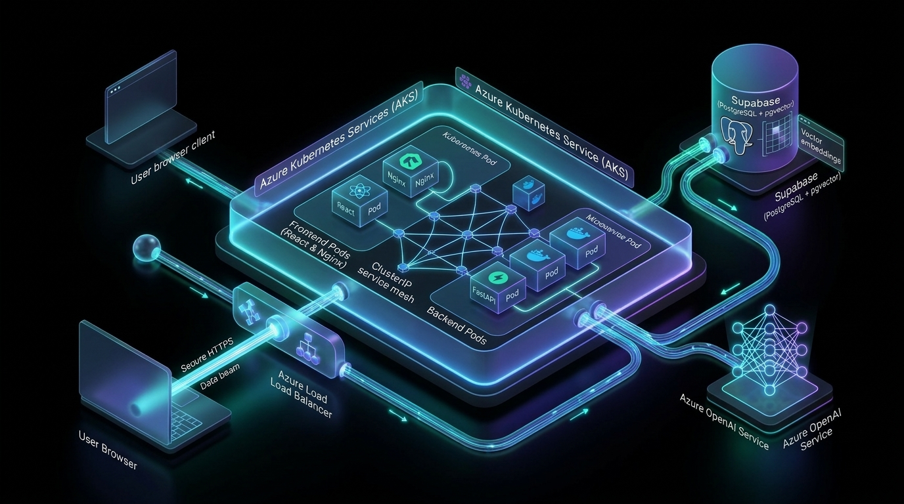
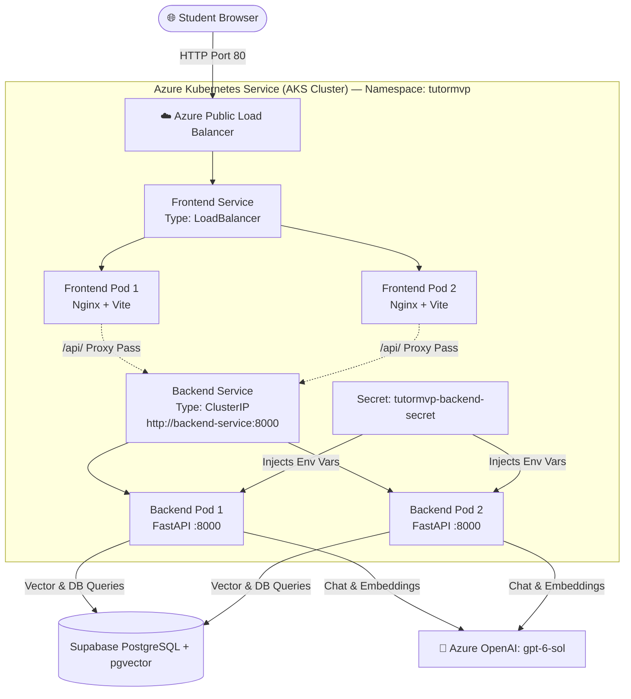
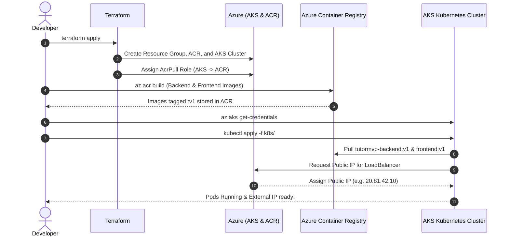

# Docker & Kubernetes (AKS) Complete Study Guide

> **Project Reference**: TutorMVP AI Study Room  
> **Target Cloud**: Microsoft Azure (AKS + ACR)  
> **Prerequisites**: No prior Docker or Kubernetes knowledge needed.

---

## 📑 Table of Contents
1. [The Big Picture: Mental Models](#1-the-big-picture-mental-models)
2. [Docker Fundamentals: Containers & Images](#2-docker-fundamentals-containers--images)
3. [Kubernetes (K8s) Core Concepts](#3-kubernetes-k8s-core-concepts)
4. [TutorMVP Architecture on Kubernetes](#4-tutormvp-architecture-on-kubernetes)
5. [Deep Dive into TutorMVP Dockerfiles](#5-deep-dive-into-tutormvp-dockerfiles)
6. [Deep Dive into TutorMVP Kubernetes Manifests](#6-deep-dive-into-tutormvp-kubernetes-manifests)
7. [Step-by-Step Deployment Walkthrough](#7-step-by-step-deployment-walkthrough)
8. [Hands-On Learning Labs (Kubernetes Superpowers)](#8-hands-on-learning-labs-kubernetes-superpowers)
9. [Kubectl Command Cheat Sheet](#9-kubectl-command-cheat-sheet)

---

## 1. The Big Picture: Mental Models

### The Traditional Problem: *"It works on my machine!"*
Before containers, deploying an app looked like this:
- Your developer machine has Python 3.11, certain C libraries installed, and specific environment variables.
- The production server has Python 3.9, missing PDF libraries (`libmupdf`), and different permissions.
- Result: **The app crashes in production.**

### The Solution: Docker (The Shipping Container)
Think of **Docker** like global shipping containers:
- Before standard shipping containers, cargo ships had to load loose barrels, bags, and crates by hand. Every boat and dock required custom equipment.
- With standard containers, the ship doesn't care whether the container has electronics, cars, or coffee beans. It just loads the standard box.
- **Docker** puts your code, Python runtime, system packages, and configs into a single standardized container image that runs identically on your laptop, Azure, AWS, or Linux.

### The Problem with 50 Containers: Kubernetes (The Harbor Master)
Now you have 10, 50, or 500 containers:
- What happens if a backend container crashes at 3 AM?
- What happens when 1,000 students join a study room simultaneously and you need 10 extra backend instances?
- How does the frontend container find the backend containers when their IP addresses change?
- **Kubernetes (often abbreviated K8s)** is the container orchestrator — the automated "Harbor Master" and "Operations Robot" that:
  1. Auto-heals crashed containers.
  2. Auto-scales replicas up or down based on load.
  3. Load-balances traffic evenly across healthy containers.
  4. Manages zero-downtime rolling updates.

---

## 2. Docker Fundamentals: Containers & Images

| Term | Analogy | Description |
| :--- | :--- | :--- |
| **Dockerfile** | **The Recipe / Blueprint** | Text file with instructions on how to build the container (base OS, installed packages, files to copy). |
| **Docker Image** | **The Frozen Pre-baked Cake** | The immutable, packaged artifact produced by building the Dockerfile. Stored in a registry. |
| **Docker Container** | **Eating the Cake (Running process)** | An active, isolated running instance of a Docker image. |
| **Container Registry** | **The App Store / Warehouse** | A cloud service (like Azure Container Registry `ACR` or Docker Hub) that stores and versions your images. |

---

## 3. Kubernetes (K8s) Core Concepts

```
┌─────────────────────────────────────────────────────────────┐
│                       Kubernetes Node                       │
│  ┌───────────────────────┐       ┌───────────────────────┐  │
│  │      Pod 1            │       │      Pod 2            │  │
│  │  ┌─────────────────┐  │       │  ┌─────────────────┐  │  │
│  │  │ Docker Container│  │       │  │ Docker Container│  │  │
│  │  └─────────────────┘  │       │  └─────────────────┘  │  │
│  └───────────────────────┘       └───────────────────────┘  │
└─────────────────────────────────────────────────────────────┘
```

### 1. Pod
- The **smallest deployable unit** in Kubernetes.
- A Pod usually wraps **one container** (or a helper sidecar container).
- Pods are **ephemeral** (they can be created, killed, or moved at any moment).
- *Rule of thumb: Never deploy bare Pods directly; always manage them with a Deployment!*

### 2. Deployment
- The **supervisor** that declares *how many* copies (replicas) of a Pod should run.
- If you declare `replicas: 2`, the Deployment controller ensures 2 healthy Pods are running. If one Pod crashes or the server burns down, it automatically schedules a new one on a healthy node.

### 3. Service
- Because Pods are mortal and their IP addresses change constantly, you cannot hardcode a Pod IP.
- A **Service** provides a **stable static IP address and DNS name** that forwards traffic to whichever Pods match its label selector (`app: tutormvp-backend`).
- Types of Services:
  - **`ClusterIP`** (Default): Internal only. Visible inside the Kubernetes cluster (e.g. `backend-service:8000`).
  - **`LoadBalancer`**: Requests a public external IP from your cloud provider (Azure) so internet users can access your frontend.

### 4. Secret & ConfigMap
- **ConfigMap**: Holds non-sensitive configs (e.g. `PORT=8000`, `ENVIRONMENT=production`).
- **Secret**: Holds encrypted or sensitive credentials (`POSTGRES_URL`, `AZURE_OPENAI_API_KEY`). Injected into Pods as environment variables without hardcoding them into Docker images.

### 5. Namespace
- A virtual boundary inside a Kubernetes cluster to organize resources (`tutormvp`).

---

## 4. TutorMVP Architecture on Kubernetes





### Why this architecture is powerful:
1. **Zero CORS Issues**: The browser only ever talks to the Frontend Load Balancer. Nginx inside the Frontend Pod acts as an internal reverse-proxy that forwards `/api/*` requests to `http://backend-service:8000/api/*`.
2. **High Availability**: If Backend Pod 1 crashes or restarts, Backend Pod 2 continues handling student requests without any downtime.
3. **Security**: The backend has **no public IP address**. It is shielded inside the cluster, accessible only from the frontend.

---

## 5. Deep Dive into TutorMVP Dockerfiles

### 1. Backend Dockerfile (`backend/Dockerfile`)
```dockerfile
# 1. Base Image: Minimal Linux Debian with Python 3.11 pre-installed
FROM python:3.11-slim

# 2. Set working directory inside the container
WORKDIR /app

# 3. Install operating-system level C dependencies needed for PDF & math parsing
RUN apt-get update && apt-get install -y --no-install-recommends \
    build-essential \
    curl \
    && rm -rf /var/lib/apt/lists/*

# 4. Copy ONLY requirements first (Takes advantage of Docker layer caching!)
COPY requirements.txt .

# 5. Install Python dependencies
RUN pip install --no-cache-dir -r requirements.txt

# 6. Copy the entire application source code
COPY . .

# 7. Document the port the container listens on
EXPOSE 8000

ENV PORT=8000

# 8. Command executed when the container starts
CMD ["uvicorn", "app.main:app", "--host", "0.0.0.0", "--port", "8000"]
```

> [!TIP]
> **Docker Layer Caching**: Why copy `requirements.txt` before `COPY . .`?  
> Docker caches each step. If you change Python code in `app/main.py`, Docker reuses the cached `pip install` layer and builds in 2 seconds instead of re-downloading all 50 packages!

---

### 2. Frontend Dockerfile (`frontend/Dockerfile`) — Multi-Stage Build
A production React app should **not** run Node.js in production. It should be built into static HTML/JS/CSS and served by Nginx.

```dockerfile
# ── STAGE 1: Build the React Application ──────────────────────────
FROM node:20-alpine AS build
WORKDIR /app

COPY package*.json ./
RUN npm ci

COPY . .
RUN npm run build   # Outputs compiled bundle to /app/dist

# ── STAGE 2: Lightweight Production Server ───────────────────────
FROM nginx:alpine

# Copy our custom Nginx config (handles reverse-proxy and React routing)
COPY nginx.conf /etc/nginx/conf.d/default.conf

# Copy ONLY the static dist files from Stage 1 (Node.js and source files are discarded!)
COPY --from=build /app/dist /usr/share/nginx/html

EXPOSE 80
CMD ["nginx", "-g", "daemon off;"]
```

> [!NOTE]
> **Why Multi-Stage Builds?**  
> If we kept Node.js, the final image would be ~1 GB. With this multi-stage build, the final Nginx image is only ~35 MB!

---

## 6. Deep Dive into TutorMVP Kubernetes Manifests

All manifests live in the [`k8s/`](file:///c:/Users/sreeh/Desktop/ASIMOVX/TutorMVP/k8s) folder:

### 1. `k8s/namespace.yaml`
```yaml
apiVersion: v1
kind: Namespace
metadata:
  name: tutormvp
```
Creates an isolated room called `tutormvp`.

---

### 2. `k8s/backend.yaml` (Deployment + Service)
Key parts explained:

```yaml
apiVersion: apps/v1
kind: Deployment
metadata:
  name: backend-deployment
  namespace: tutormvp
spec:
  replicas: 2   # <── Tells Kubernetes: Always keep 2 copies running!
  selector:
    matchLabels:
      app: tutormvp-backend
  template:
    metadata:
      labels:
        app: tutormvp-backend
    spec:
      containers:
        - name: backend
          image: tutormvpacrxlfz7.azurecr.io/tutormvp-backend:v1
          ports:
            - containerPort: 8000
          envFrom:
            - secretRef:
                name: tutormvp-backend-secret  # Injects Supabase & Azure OpenAI keys
          resources:
            requests:
              cpu: "250m"       # Guarantees 0.25 CPU core
              memory: "512Mi"   # Guarantees 512 MB RAM
            limits:
              cpu: "1000m"      # Max 1 full CPU core
              memory: "1536Mi"  # Max 1.5 GB RAM
          livenessProbe:        # <── Health Checker: If /api/health fails, restarts container!
            httpGet:
              path: /api/health
              port: 8000
            initialDelaySeconds: 15
            periodSeconds: 20
---
apiVersion: v1
kind: Service
metadata:
  name: backend-service
  namespace: tutormvp
spec:
  type: ClusterIP   # <── Internal only! Accessible at http://backend-service:8000
  selector:
    app: tutormvp-backend
  ports:
    - protocol: TCP
      port: 8000
      targetPort: 8000
```

---

### 3. `k8s/frontend.yaml` (Deployment + LoadBalancer Service)

```yaml
apiVersion: v1
kind: Service
metadata:
  name: frontend-service
  namespace: tutormvp
spec:
  type: LoadBalancer   # <── Tells Azure: Provision a public internet IP!
  selector:
    app: tutormvp-frontend
  ports:
    - protocol: TCP
      port: 80
      targetPort: 80
```

---

## 7. Step-by-Step Deployment Walkthrough

Here is the exact workflow you ran:



---

## 8. Hands-On Learning Labs (Kubernetes Superpowers)

Once your pods are running, test these 4 interactive labs to experience why companies use Kubernetes:

### Lab 1: Test Pod Self-Healing 🩺
Kubernetes constantly monitors your desired state (`replicas: 2`). If a pod dies, it immediately creates a new one.

1. List your running backend pods:
   ```powershell
   kubectl get pods -n tutormvp
   ```
2. Pick one of the backend pod names and kill it:
   ```powershell
   kubectl delete pod <backend-pod-name> -n tutormvp
   ```
3. Immediately run:
   ```powershell
   kubectl get pods -n tutormvp
   ```
   **Observation**: You will see the old pod terminating and a brand-new replacement pod already spawned and `Running` within 2 seconds!

---

### Lab 2: Instant Pod Scaling 📈
Imagine your app suddenly gets featured and 1,000 students join.

1. Scale backend replicas from 2 to 5 with one command:
   ```powershell
   kubectl scale deployment backend-deployment --replicas=5 -n tutormvp
   ```
2. Watch Kubernetes spin up the 3 new pods instantly:
   ```powershell
   kubectl get pods -n tutormvp
   ```
3. Scale back down when traffic subsides:
   ```powershell
   kubectl scale deployment backend-deployment --replicas=2 -n tutormvp
   ```

---

### Lab 3: Live Pod Inspection & Terminal Exec 🔍
Want to look inside a running container?

1. Open a live bash shell inside a backend pod:
   ```powershell
   kubectl exec -it <backend-pod-name> -n tutormvp -- /bin/bash
   ```
2. Look around inside the container:
   ```bash
   python --version
   ls -la app/
   env | grep OPENAI
   exit
   ```

---

### Lab 4: Stream Live Logs 📜
Monitor real-time requests hitting your backend:

```powershell
kubectl logs -f deployment/backend-deployment -n tutormvp
```
Send a message in the study room, and you will see the logs stream live!

---

## 9. Kubectl Command Cheat Sheet

| Command | What it does |
| :--- | :--- |
| `kubectl get pods -n <ns>` | Lists all pods and their health status |
| `kubectl get svc -n <ns>` | Shows services, ports, and Public LoadBalancer IPs |
| `kubectl get deployments -n <ns>` | Displays deployments and replica status |
| `kubectl describe pod <name> -n <ns>` | Shows detailed events and debugging info (great for troubleshooting) |
| `kubectl logs -f <pod-name> -n <ns>` | Streams live stdout/stderr logs from a pod |
| `kubectl exec -it <pod-name> -n <ns> -- sh` | Opens an interactive shell inside a running pod |
| `kubectl scale deployment <name> --replicas=N -n <ns>` | Scales pod count up or down |
| `kubectl delete -f k8s/` | Deletes all resources defined in the folder |

